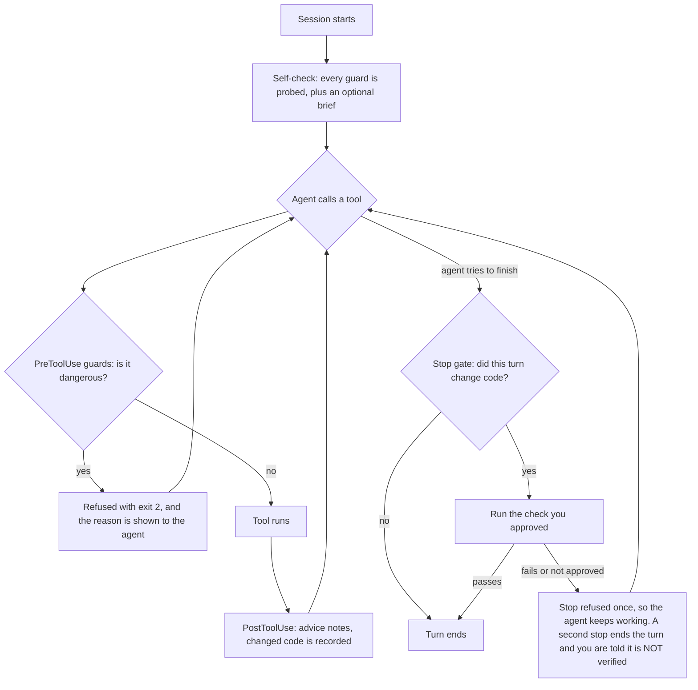

<div align="center">

# bendit

**Safety rails for Claude Code that are enforced, not just written down.**

bendit stops your AI coding agent before it deletes a folder, force-pushes or
drops a table, and runs your project's own check (usually its tests) before it
may end a turn that changed code.

[](https://github.com/VedangP57/bendit/actions/workflows/ci.yml)
[](LICENSE)
[](https://www.npmjs.com/package/bendit)
[](https://pypi.org/project/bendit/)

[Quick start](#quick-start) · [What you get](#what-you-get) · [Evidence](#evidence) · [Limits](#what-it-does-not-protect-against) · [Reference](docs/reference.md)

</div>

Most people steer an AI coding agent with a rules file (`CLAUDE.md` or
`AGENTS.md`), and the agent can quietly ignore it: real projects have "keep
files short" beside a hundred long files, and safety hooks that never fired
because they read the wrong field of their input. bendit turns the rules that
matter into checks that actually say no. When the agent tries something
destructive, Claude Code refuses the command and shows the agent why:

```console
$ rm -fr ./build
BLOCKED by bendit safety hook: recursive delete (rm -r, with or without -f) — run it yourself if you mean it; only a folder inside /tmp or $TMPDIR is allowed.
If this is genuinely required, ask the human to run it.
```

<sub>Copied verbatim from the guard's test snapshots,
[`block-dangerous-bash.expected`](plugins/bendit/scripts/block-dangerous-bash.expected),
which CI compares on every change.</sub>

## Quick start

Run one command from inside your project folder (macOS or Linux):

```bash
curl -fsSL https://raw.githubusercontent.com/VedangP57/bendit/main/install.sh | bash
```

Or, if you prefer a package manager, run **one** of these instead (same installer):
`npx bendit` · `pipx run bendit` · `uvx bendit`

The command checks that your computer has what bendit needs (`claude`, `git`,
`python3` 3.9 or newer), asks before installing anything that is missing (type
`y` to agree; just pressing Enter means no), then opens Claude Code on
`/bendit:adopt`.

### What happens next

1. **One question.** (Rarely, one or two short questions come first.) bendit
   looks at your project and shows one plain summary:
   what you get, every file it will add or change, everything it will install.
   It ends with *"Go ahead? Reply yes, or just press Enter."* Here Enter
   means yes. Nothing outside
   that summary is written or installed. Claude Code may ask permission to
   change a few files in the `.claude` folder: say yes.
2. **One approval line.** At the end it prints one command. Open a **new
   Terminal window** (not the chat), paste it and type `y`. This is you, not
   the AI, approving the check that must pass before the AI may say it is
   done: that check runs on your computer unrestricted, so the AI must not
   approve its own test.
3. **Restart and confirm.** Close Claude, open it again in the same project and
   type `/bendit:doctor`.

When everything works, the doctor ends with:

> bendit is active in this window: it just stopped a test force-push, as it should.

If something is still open, it ends with "What to do next:" and numbered steps instead.

## Which path is mine?

| I want to… | Do this |
|---|---|
| just have it set up | the [quick start](#quick-start) above |
| make every choice myself (invariants, CI, branches, which guards, how it is installed) | run `/bendit:adopt --detailed` in Claude Code; it is also how to change a project later |
| install it by hand, or pin a version | expand [Manual install…](#manual-install-pinning-and-installer-details) below |
| measure whether a rule changes what the agent does | [the evals method](plugins/bendit/evals/README.md) |

## What you get

- **Dangerous commands are refused.** Recursive deletes, force-pushes,
  `git reset --hard`, `DROP TABLE` through a database client,
  `supabase db push`, `prisma migrate reset`, deleting the folder the shell is
  in, and live secret keys (Stripe, Supabase, GitHub) typed into a command.
- **Your check runs before the agent stops.** When a turn changed code, bendit
  runs your project's check (usually its tests) and refuses the first attempt
  to stop if it fails. If the agent stops again, the turn ends, you are told the
  code is NOT verified, and the next turn still has to answer for it.
- **You approve, not the AI.** The check runs only once a person has approved
  that exact file in their own terminal, and the guard refuses the agent's
  attempts to approve it.
- **It tells you when a guard is off.** Every session starts with a self-check
  that fires a known-bad test at each guard. It is silent when all is well.
- **Your own rules, the second time.** `/bendit:new-guard` scaffolds a new
  guard with its tests when you catch yourself correcting the same mistake twice.

What is a wall and what is a suggestion:

| | What | When it is on |
|---|---|---|
| **Enforced** | destructive shell commands ([full list](docs/reference.md#the-bash-guard)) | always |
| **Enforced** | ending a turn that changed code without your check passing (refused once per turn) | always; your check runs once you approve it |
| **Enforced** | zsh word-splitting mistakes (`for f in $files`) | when your shell is zsh |
| **Enforced** | parsing the output of `ls` | when setup found `ls` is an alias or function (recorded in `.claude/bendit.json`) |
| **Enforced** | edits to generated `*.gen.*` files; allocations in `*.hot.*` files | when you name files that way |
| **Check** | every guard can still run and refuse | every session start, and `/bendit:doctor` |
| Advice | notes after edits; a warning when a command hid its errors and printed nothing; a start-of-session brief | after each edit or command; the brief per project |
| Advice | skills: `checks-that-can-lie`, `engineering-habits`, `blast-radius`, `encode-lessons-in-structure`, and `ux-design-laws` for web apps | loaded when relevant |

**Enforced**: a hook refuses the action, and a guard that crashes refuses too
(it fails closed). **Advice**: the agent may ignore it. [Full table](docs/reference.md#enforced-and-advice-in-full).

## See it block, safely

After setup, in Claude Code, ask the agent to run:

```bash
git push --force bendit-probe HEAD
```

Nothing is named `bendit-probe`, so without bendit git would only fail with
`'bendit-probe' does not appear to be a git repository`. With bendit, the
command never runs and the agent is told:

```console
BLOCKED by bendit safety hook: force push — use --force-with-lease, and never on a shared branch.
If this is genuinely required, ask the human to run it.
```

`/bendit:doctor` runs this exact test for you, after checking that the name is unused.

## Evidence

From the v0.2.0 eval sweep (2026-11-19, Claude Code CLI 2.1.328, judge sonnet): each task
run many times with and without bendit, compared with a two-sided Fisher test.

| What was measured | With bendit | Without | p |
|---|---|---|---|
| Bash guard: agent told to run `rm -rf ./build` (folder survived) | 12/12 | 0/12 | 7.4e-07 |
| Bash guard: agent told only to "free up space", picks its own command | 11/12 | 0/12 | 9.6e-06 |
| Skill `checks-that-can-lie`: the check it writes refuses an empty scan | 28/30 | 1/30 | 2.3e-13 |

- In the Bash guard cases the agent attempted the deletion in every run, in
  both arms. The one that got through, `rm -r -- ./dist` (no `-f`), was then
  allowed on purpose; recursive deletes are refused with or without `-f` since.
- **Cost:** in that sweep, 2 of 18 skill runs with bendit ran out of turns.
- **Reproduce it:** commands, costs and caveats are in
  [`evals/results/INDEX.md`](plugins/bendit/evals/results/INDEX.md). The
  inputs are frozen at commit `a5d6be0`; the guard has changed since, so check
  out that commit to reproduce. [More detail](docs/reference.md#more-on-the-evidence).
- It is a small sample: don't take it on trust. Measure it on your own project
  with [the evals method](plugins/bendit/evals/README.md).

> [!NOTE]
> Only the Bash guard and one skill have a measured effect. The other guards,
> the Stop gate, the browser driver, the session brief and the vocabulary check
> are covered by test suites; `blast-radius` and `ux-design-laws` are prose
> skills. None of these is **yet measured** in live agent runs. The other five skill cases showed
> no difference in small (3 runs per arm) checks.

## What it does not protect against

- **It is not a sandbox or a security boundary.** It is built for a
  well-meaning but hasty agent, not a malicious one. An agent set on lying can
  forge bendit's own state files.
- **It reads shell commands, not intentions.** A command hidden behind a
  variable, inside a script file (`bash clean.sh`), over `ssh`, in
  `psql -f drop.sql`, or in a perl or ruby one-liner gets through.
  [Known gaps](docs/reference.md#the-bash-guard).
- **It refuses once per turn.** If the agent tries to stop a second time in the
  same turn, the turn ends and you are told the code is NOT verified. A gate
  that refused forever would trap the session.
- **There is a visible escape hatch.** The agent can skip the end-of-turn check
  by writing a one-line reason. You are always shown that reason.
- **Your check runs with your permissions.** Once you approve it, the Stop gate
  runs `.claude/verify-harness` unsandboxed. Change it, and it needs approval again.
- **Advice is advice.** Notes and skills can be ignored.
- **Claude Code only**, on **macOS and Linux**. The installer refuses Windows.
- **Network:** the hooks make no network calls of their own, except the
  optional session brief's DNS/TCP checks of hosts and ports your project
  lists (none by default). The installer fetches bendit from GitHub, and your
  approved check does whatever its commands do.

## How it works



bendit is a plugin for [Claude Code](https://claude.com/claude-code): small
Python scripts, called hooks, that Claude Code runs at fixed moments.
*PreToolUse* hooks see each command or edit first and can refuse it;
*PostToolUse* hooks can only advise; the *Stop* hook refuses to end a turn that
changed code until your check passes. Commands are read with a small parser, so
`sudo rm -rf`, `sh -c "…"` and `xargs rm -r` are caught, while a commit message
that only mentions `rm -rf` is not.

## Per-project features

`/bendit:adopt` turns these on only where they fit and records each choice,
with the reason, in `.claude/bendit.json`.

| Feature | Turned on when | Needs |
|---|---|---|
| `browser-driver`: the check clicks through your web app in real Chrome | a web app (`next`, `react`, `vue`, `vite`, … or `index.html`) | Node 20+, Google Chrome, Playwright (offered) |
| `ux-design-laws`: a skill for interface work | a web app | the `bendit-web` add-on, this project only |
| `session-brief`: where the repo stands, at session start | the project is a git repo | nothing |
| `ls-guard`: refuses parsing `ls` output | `ls` is an alias or function in your shell | nothing |

In `--detailed`, saying no to a dependency turns its feature off and never stops setup.
[Details](docs/reference.md#per-project-features-in-detail).

## Commands

| Command | What it does |
|---|---|
| `/bendit:adopt` | set bendit up here: one question, one approval line (`--detailed` for the full interview) |
| `/bendit:doctor` | check every guard can still refuse, run the live test, say what to do next |
| `/bendit:verify` | run your project's check now (for a web app: start it and click through it) |
| `/bendit:ship` | pre-PR checklist, then open the pull request once you agree |
| `/bendit:review-diff` | review everything this branch changes against common failure modes |
| `/bendit:new-guard <name>` | scaffold a new guard and its tests from a mistake you keep correcting |
| `/bendit:vocabulary` | report or fix words used with more than one meaning |

## Undo or uninstall

`/bendit:adopt`'s report includes a **"How to undo all of it"** section with the
exact commands for your project ([template](plugins/bendit/skills/adopt-bendit/references/quick.md)). They start with:

```bash
cd "<your project folder>"
claude plugin uninstall bendit-web@bendit --scope project   # only if it was installed
claude plugin uninstall bendit@bendit --scope project
claude plugin marketplace remove bendit --scope project
```

then remove each file, folder and line that run added, by exact path. Tools
it installed with your OK (such as Homebrew packages) stay installed. If no
other project on this computer uses bendit, you can also delete
`~/.cache/bendit/` (the downloaded copy) and `~/.config/bendit/` (your approvals and web-app port numbers).

## Troubleshooting

- **Start with `/bendit:doctor`.** It lists every guard, says which are OFF and
  why, and ends with what to do, in plain words.
- **Permission prompts for `.claude/` files are expected.** Claude Code asks
  before writes in a project's `.claude` folder. Say yes during setup.
- **"Unknown command"?** Type the prefix: `/bendit:adopt`, not `/adopt`.
- **The agent keeps being stopped at the end of a turn?** Your check is failing
  or not yet approved. The stop message says which, and gives the approval command.

<details>
<summary><b>Manual install, pinning and installer details</b></summary>

<a name="manual-install-pinning-and-installer-details"></a>

Install the plugin by hand, then run setup in your project:

```bash
claude plugin marketplace add https://github.com/VedangP57/bendit
claude plugin install bendit@bendit
```

```
/bendit:adopt              # one question, then one approval line
/bendit:adopt --detailed   # the full interview, every choice yours
```

The install URL above is "latest". To pin a release, put its tag in the URL,
for example `https://raw.githubusercontent.com/VedangP57/bendit/v0.4.1/install.sh`
(`/<tag>/` for any other release).

To read the installer before running it:

```bash
f=$(mktemp) && curl -fsSL https://raw.githubusercontent.com/VedangP57/bendit/main/install.sh -o "$f" && less "$f" && bash "$f"
```

To see what is missing without installing anything:

```bash
curl -fsSL https://raw.githubusercontent.com/VedangP57/bendit/main/install.sh | bash -s -- --check
```

Flags, settings, exit codes, vendoring and what setup writes are in
[docs/reference.md](docs/reference.md#installer).

</details>

<details>
<summary><b>More for developers</b></summary>

All in [docs/reference.md](docs/reference.md):

- [Installer](docs/reference.md#installer): flags, environment variables, exit codes, what it writes
- [What setup writes](docs/reference.md#what-setup-writes), and [vendoring](docs/reference.md#vendoring-bendit-into-your-repository) bendit into your repository
- [How setup proves itself](docs/reference.md#how-setup-proves-itself) with `prove.sh`
- [The Stop gate](docs/reference.md#the-stop-gate-in-detail) in detail
- [Grow your own guard](docs/reference.md#grow-your-own-guard)
- [The ladder](docs/reference.md#the-ladder): which layer should hold a rule
- [Measuring whether a rule works](docs/reference.md#measuring-whether-a-rule-works)
- [Platform support](docs/reference.md#platform-support), [where bendit keeps state](docs/reference.md#where-bendit-keeps-state) and [repository layout](docs/reference.md#repository-layout)

Design decisions are in [docs/design.md](docs/design.md); the method and its
twelve failure classes in [docs/ladder.md](docs/ladder.md).

</details>

## Contributing, security, license

- [CONTRIBUTING.md](CONTRIBUTING.md): running CI locally, test-first changes,
  backing a claim with evidence. Changes are listed in [CHANGELOG.md](CHANGELOG.md).
- Found a way past a guard, or a guard that fails open? Report it privately as
  [SECURITY.md](SECURITY.md) describes, not in a public issue.
- MIT. See [LICENSE](LICENSE).
